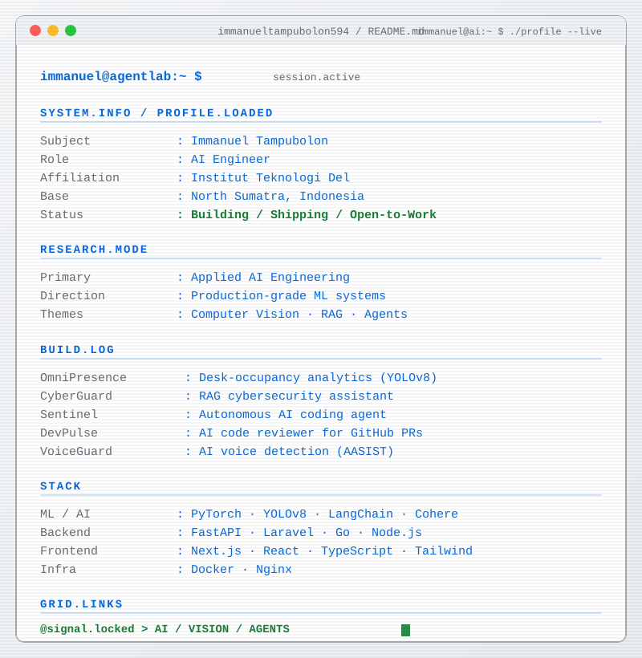

  

---

## Hi 👋, I'm Immanuel Tampubolon

I'm an **AI Engineer Intern** based in North Sumatra, Indonesia, currently pursuing **D3 Computer Technology at Institut Teknologi Del**. I build AI systems that have to work on real input — not on a demo prompt. My focus: **LLM agents, RAG, computer vision, and multi-agent systems** that survive production — where retrieval quality and graceful degradation matter more than impressive demos.

- 🚧 Currently building **OmniPresence-AI** — workplace desk-occupancy analytics from CCTV video, using object detection and multi-object tracking
- 🔭 Also shipping **Sentinel** (autonomous self-correcting coding agent) and **AnomalyGuard** (multi-agent network anomaly detection)
- 🎓 Thesis in progress: splitting **CyberGuard AI** into modular retriever/verifier/responder agents with LoRA fine-tuning for Indonesian-language digital-fraud detection
- 🌱 Currently exploring **agentic orchestration**, **retrieval quality evaluation (RAGAS)**, and **graceful degradation patterns** (circuit breakers, rule-based fallback)
- 💼 All projects & demos on my [Portfolio](https://portfolio-gamma-blush-68.vercel.app)
- 🤝 **Seeking an AI Engineer Internship** — available onsite, relocation abroad, or remote
- 📫 Reach me: **immanueltampubolon594@gmail.com**
- ⚡ Fun fact: coffee, music, and code are my three basic needs

---

## 🌐 Socials

---

## 💻 Tech Stack

<strong>Languages</strong> 

<strong>LLM & Agents</strong> 

<strong>Computer Vision</strong> 

<strong>Retrieval, Evaluation & ML</strong> 

<strong>Backend</strong> 

<strong>Frontend</strong> 

<strong>Data & DevOps</strong> 

---

## 📊 GitHub Stats

  

  

  

---

  🚀 <em>Building AI that survives production. Open to internships — onsite, remote, or abroad.</em>

